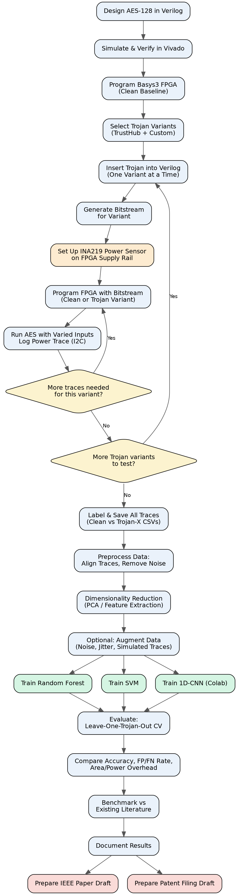
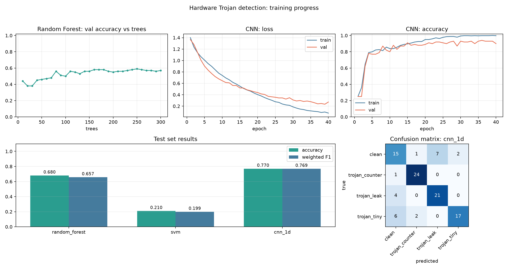

<div align="center">

# 🔬 HardwareTrojanML

### Detecting Hardware Trojans in an FPGA AES-128 core from its power signature, using Machine Learning

<p>
  
  
  
  
  
  
</p>

**Side-channel analysis · Real hardware · Real measurements**

[Overview](#-overview) •
[How it works](#-how-it-works) •
[Trojans](#-the-trojan-variants) •
[Results](#-results) •
[Quick start](#-quick-start) •
[Repo layout](#-repository-layout) •
[Roadmap](#-roadmap)

</div>

---

## 📖 Overview

Modern chips are designed in one place and manufactured in another, often by a third party that the designer can't fully trust. A malicious actor in that chain can slip in a **Hardware Trojan**: a small piece of extra circuitry that stays silent during normal operation and only activates on a rare, attacker-chosen trigger. Once active it can leak secret keys, corrupt outputs, or shut the chip down.

Functional testing can't reliably find these, because an un-triggered Trojan behaves exactly like a clean chip. **But it still exists physically, and extra logic draws extra power.**

This project takes a **side-channel approach**: instead of looking for the Trojan's *behaviour*, we measure the board's *power draw* and train machine-learning models to tell a clean design from an infected one.

| | |
|---|---|
| **Target design** | AES-128 encryption core in Verilog (verified against the FIPS-197 test vector) |
| **Platform** | Digilent Basys3 (Xilinx Artix-7 `xc7a35tcpg236-1`) |
| **Measurement** | INA219 current/power sensor, Arduino bridge, 500 samples/s |
| **Classes** | `clean`, `trojan_leak`, `trojan_counter`, `trojan_tiny` |
| **Models** | Random Forest · RBF-SVM · 1D-CNN (PyTorch) |

> **Team ECSc_14**, School of Electronics Engineering, KIIT Deemed to be University<br>
> Adyasha Mohanty · Ayush Anand · Ayushman Mahapatra · Bidisha Jana<br>
> Supervisors: Prof. Swati Swayamsiddha & Prof. Kananbala Ray

---

## ⚙️ How it works

<div align="center">
  
</div>

1. **Design:** a clean AES-128 core plus three Trojan-infected variants with different triggers and payloads.
2. **Measure:** each bitstream is programmed onto the Basys3 in turn. An INA219 sits in-line on the supply rail and an Arduino streams current, voltage and power over serial.
3. **Prepare:** corrupted samples are rejected, then each recording is cut into overlapping windows of 128 samples (2 channels: `current_mA`, `power_mW`) and each window is z-normalised.
4. **Classify:** Random Forest, SVM and a small 1D-CNN are trained to predict which of the four designs produced a given window.

---

## 🧬 The Trojan variants

All three behave **identically to the clean core until triggered**, so the only thing that gives them away is the physical footprint of the extra logic.

| Variant | Trigger | Payload | Extra hardware |
|---|---|---|---|
| **`trojan_leak`**<br/>*rare-pattern, data-based* | Plaintext equals `DEADBEEF·DEADBEEF·DEADBEEF·DEADBEEF` | Leaks the first round-key byte on a spare `leak_out` port | 128-bit comparator + 8-bit register |
| **`trojan_counter`**<br/>*time-delayed, sequential* | Hidden 8-bit counter reaches 128 encryptions (then every 128th) | Flips the LSB of the ciphertext | 8-bit counter + comparator + XOR |
| **`trojan_tiny`**<br/>*minimal footprint* | `plaintext[7:0] == 0x5A` (1 in 256) | Flips one ciphertext bit | 8-bit comparator + XOR |

`trojan_tiny` is deliberately the **hardest to detect**. It is the experiment for showing how detection quality degrades as Trojan size shrinks.

---

## 📊 Results

Four-class classification on a held-out test set of **100 windows (25 per class)**:

| Model | Accuracy | Weighted F1 |
|---|:---:|:---:|
| Random Forest (300 trees) | 68.0 % | 0.657 |
| SVM (RBF) | 21.0 % | 0.199 |
| **1D-CNN** | **77.0 %** | **0.769** |

<div align="center">
  
  <br><sub><i>Training dashboard: RF validation accuracy vs trees, CNN loss and accuracy, test results, CNN confusion matrix.</i></sub>
</div>

### 1D-CNN, per-class recall

| Class | Correct / 25 | Recall |
|---|:---:|:---:|
| `trojan_counter` | 24 | **96 %** |
| `trojan_leak` | 21 | **84 %** |
| `trojan_tiny` | 17 | **68 %** |
| `clean` | 15 | **60 %** |

Collapsing the confusion matrix to a binary *clean vs. any Trojan* view, the CNN misses **11 of 75** Trojan windows (**FNR ≈ 14.7 %**) and flags **10 of 25** clean windows as infected (**FPR = 40 %**). As expected, the smallest Trojan (`trojan_tiny`) is the one most often mistaken for `clean`.

> The SVM scores below the 25 % chance level for four classes, so treat it as an **untuned baseline** (default `C=1`, `gamma="scale"`), not a verdict on SVMs for this task.

---

## 🗂️ Dataset

Raw INA219 recordings, one CSV per bitstream, about **22.7 s** and **~11.1 k samples** each (2 ms sampling interval).

| File | Class label | Samples | Windows (train / val / test) | Mean current |
|---|---|:---:|:---:|:---:|
| `clean_session1.csv` | `clean` | 11,139 | 120 / 25 / 25 | 118.35 mA |
| `trojan_leak.csv` | `trojan_leak` | 11,187 | 121 / 25 / 25 | 117.99 mA |
| `trojan_counter.csv` | `trojan_counter` | 11,161 | 121 / 25 / 25 | 118.83 mA |
| `trojan_tiny.csv` | `trojan_tiny` | 11,284 | 122 / 25 / 25 | 119.25 mA |

**Columns:** `pc_timestamp, arduino_micros, current_mA, busVoltage_V, power_mW`

**Naming convention:** the file name *is* the label. The notebook strips a trailing `_session<N>`, so `clean_session1.csv` becomes `clean`. To add a new class, just drop in `<label>.csv`.

---

## 🧠 ML pipeline

Everything lives in [`trojan_training.ipynb`](trojan_training.ipynb).

| Stage | Details |
|---|---|
| **Outlier removal** | Drop any sample where current, power or bus voltage deviates more than **5 %** from the recording's median (removes serial/ADC glitches) |
| **Windowing** | `128` samples per window, stride `64` (50 % overlap), channels `current_mA` + `power_mW` |
| **Split** | Chronological **70 / 15 / 15** per recording, so windows from different splits never come from the same time span |
| **Normalisation** | Per-window z-score (removes absolute DC level so models focus on *shape*), then a `StandardScaler` for RF/SVM. Set `USE_LEVEL = True` to feed the mean level back in |
| **Random Forest** | 300 trees, grown incrementally (+10 at a time) with live validation curve, balanced class weights |
| **SVM** | RBF kernel, `C=1.0`, `gamma="scale"`, balanced class weights |
| **1D-CNN** | `Conv(16,k5)→Conv(32,k5)→MaxPool→Conv(64,k3)`, each with BatchNorm + ReLU, then global average pooling and a linear head. Adam, lr `1e-3`, 40 epochs, batch 64 |
| **Reproducibility** | Global `SEED = 42` |
| **Outputs** | `artifacts/metrics.json`, `artifacts/trojan_models.pkl` (scaler, label encoder, RF, SVM, CNN weights), `artifacts/training_dashboard.png` |

---

## 🚀 Quick start

### 1. Train on the included data

```bash
git clone https://github.com/adyashaexe/HardwareTrojanML.git
cd HardwareTrojanML

python -m venv .venv
source .venv/bin/activate          # Windows: .venv\Scripts\activate
pip install -r requirements.txt
pip install jupyter ipykernel      # if you don't already have Jupyter

jupyter notebook trojan_training.ipynb   # Run All
```

The notebook draws a live training dashboard and writes everything to `artifacts/`.

### 2. Collect your own power data

<details>
<summary><b>Wiring and logging steps (click to expand)</b></summary>

<br>

**Wiring**

| Connection | To |
|---|---|
| INA219 `VCC` / `GND` | Arduino `5V` / `GND` |
| INA219 `SDA` / `SCL` | Arduino `A4` / `A5` |
| Supply `(+)` | INA219 `VIN+` |
| INA219 `VIN−` | Basys3 positive power input |
| Supply `(−)`, Basys3 `(−)`, Arduino `GND` | **All tied together (common ground)** |

> Without a common ground the voltage reading is just noise.

**Flash the Arduino:** open [`power_logging/ina219_stream.ino`](power_logging/ina219_stream.ino), install the *Adafruit INA219* library, upload. The sketch uses a 0.1 Ω shunt calibration (0.1 mA/LSB), 400 kHz I²C, 500 000 baud and one sample every 2 ms.

**Log a session** (program the Basys3 with the bitstream first):

```bash
cd power_logging
pip install pyserial pandas numpy

python log_power_session.py --list                                   # find your port
python log_power_session.py --port COM5 --output ../datasets/trojan_leak.csv --duration 40
```

On Mac/Linux the port looks like `/dev/ttyACM0` or `/dev/tty.usbmodem14101`. The logger rejects corrupted lines (out-of-range V/I, power ≠ V×I, jumping timestamps), refuses to overwrite files without `--force`, and prints the measured sample rate.

**Optional: cut a session into per-encryption traces**

```bash
python segment_traces.py --input clean_session.csv --label clean --output clean_traces.csv
```

Check the printed *Detected N traces* against how many times you pressed `BTNC`, and tune `--threshold-multiplier` / `--window-size` if it's off. See [`power_logging/README.md`](power_logging/README.md) for details.

</details>

### 3. Build and test the FPGA designs

<details>
<summary><b>Vivado workflow (click to expand)</b></summary>

<br>

1. **New RTL project** → board *Digilent Basys3* (or part `xc7a35tcpg236-1`).
2. **Design sources** (from [`aes_128_verilog/`](aes_128_verilog/)): `aes_sbox.v`, `key_expansion.v`, `aes_transforms.v`, `basys3_top.v`, plus **one** of `aes_128.v` / `aes_128_trojan_leak.v` / `aes_128_trojan_counter.v` / `aes_128_trojan_tiny.v`.
3. **Constraints:** add `basys3_constraints.xdc`, set `basys3_top` as top module.
4. **Pick the variant:** in `basys3_top.v`, change the `aes_128 dut (...)` instantiation to the Trojan module you want. Note that `aes_128_trojan_leak` has an extra `leak_out` port you'll need to wire.
5. **Simulate first:** add `tb_aes_128.v` as a simulation source and run a behavioural simulation. It should print `PASS: matches FIPS-197 test vector`.
6. **Synthesis → Implementation → Generate Bitstream → Program Device.**
7. **Verify on the board:**
   - `BTNU` = reset, `BTNC` = start encryption, `LED15` lights when done
   - `SW[3:0]` selects which ciphertext byte shows on `LED[7:0]`
   - Expected ciphertext: `69 c4 e0 d8 6a 7b 04 30 d8 cd b7 80 70 b4 c5 5a`

The wrapper encrypts the fixed FIPS-197 vector (`key = 000102…0f`, `plaintext = 001122…ff`) on each button press.

Keep a record of which bitstream is which. You'll reprogram the same board once per class.

</details>

---

## 📁 Repository layout

```
HardwareTrojanML/
├── aes_128_verilog/              FPGA design
│   ├── aes_128.v                     clean AES-128 baseline
│   ├── aes_128_trojan_leak.v         Trojan 1: rare-pattern trigger, key leak
│   ├── aes_128_trojan_counter.v      Trojan 2: counter trigger, ciphertext corruption
│   ├── aes_128_trojan_tiny.v         Trojan 3: minimal-footprint trigger and payload
│   ├── aes_sbox.v · key_expansion.v · aes_transforms.v
│   ├── basys3_top.v                  board wrapper (button start, LED readout)
│   ├── basys3_constraints.xdc        pin mapping
│   └── tb_aes_128.v                  FIPS-197 testbench
├── power_logging/                Measurement pipeline
│   ├── ina219_stream.ino             Arduino sketch (500 Hz CSV stream)
│   ├── log_power_session.py          validated serial logger
│   ├── segment_traces.py             optional per-encryption segmentation
│   └── README.md
├── datasets/                     Raw recordings (one CSV per class)
├── trojan_training.ipynb         Preprocessing + RF / SVM / 1D-CNN training
├── artifacts/                    metrics.json · trained models · dashboard PNG
├── docs/project_flowchart.png    Project flowchart
└── requirements.txt
```

---

## ⚠️ Limitations

Worth keeping in mind when reading the numbers above:

- **One recording per class.** Each class comes from a single ~23 s session. Small differences in supply voltage between sessions (≈6.63 V → 6.60 V → 6.57 V across recordings) mean the classifier may partly be learning *session conditions* and not only the Trojan's footprint. Repeated sessions per class, with power-cycles in between, would test this directly.
- **Coarse sampling.** The INA219 samples at 500 Hz while the FPGA runs at 100 MHz, so individual AES rounds can't be resolved. The models see low-frequency power behaviour of each bitstream, not cycle-level traces.
- **Small test set.** 100 windows total (25 per class), so each percentage point is one window, and results will move noticeably with a different split or seed.
- **Seen-Trojan evaluation only.** Models are tested on the *same* Trojan types they were trained on, which doesn't yet show generalisation to an unseen Trojan.

---

## 🗺️ Roadmap

- [x] Clean AES-128 core verified against FIPS-197
- [x] Three Trojan variants with distinct trigger mechanisms
- [x] Basys3 wrapper and constraints
- [x] INA219 + Arduino measurement pipeline with validated logger
- [x] Labelled dataset for 4 classes
- [x] RF / SVM / 1D-CNN training with live dashboard and saved artifacts
- [ ] Multiple sessions per class, with train/test split across *sessions*
- [ ] Leave-one-Trojan-out evaluation (generalisation to unseen Trojans)
- [ ] Tune the SVM; try PCA / feature engineering
- [ ] Higher-rate acquisition for finer-grained traces
- [ ] Additional Trojan variants (target 4–6)
- [ ] Benchmark against published results, write-up / paper draft

---

## 🧰 Hardware & software

| Item | Notes |
|---|---|
| Digilent **Basys3** (Artix-7) | Target FPGA board |
| **INA219** current/power module | In-line on the board's supply rail |
| **Arduino** Uno/Nano | I²C → USB-serial bridge |
| Xilinx **Vivado** (WebPACK) | Synthesis, simulation, bitstreams |
| **Python 3.10+** | `numpy`, `pandas`, `scikit-learn`, `matplotlib`, `torch`, `nbformat` (see [`requirements.txt`](requirements.txt)) |

---

## 📚 References

1. Zantout, *Hardware Trojan detection on FPGA AES via power traces* (UC Irvine thesis, 2018)
2. Puspa et al., *ML-based hardware Trojan detection* (arXiv, 2024)
3. John, Pitta, Dofe & Pandey (2025), Artix-7 + AES-128 + ML on power traces
4. [Trust-Hub](https://trust-hub.org/) hardware Trojan benchmarks

---

<div align="center">
<sub>Built by Team ECSc_14 · KIIT School of Electronics Engineering</sub>
</div>
