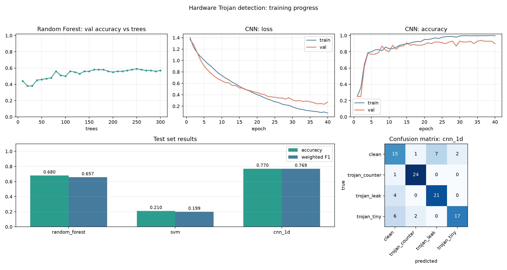
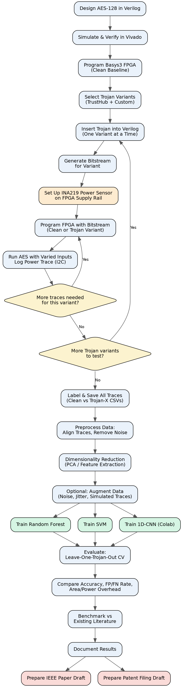

<div align="center">

# HardwareTrojanML

### The threat is hidden in the logic. The signal is hiding in the power.

**Machine-learning-assisted hardware Trojan detection through side-channel power analysis.**

<p>
  
  
</p>
<p>
  
  
  
  
  
</p>

[Pipeline](#-how-it-works) · [Results](#-results) · [Quick start](#-quick-start) · [Hardware](#-hardware-experiment) · [Limitations](#-limitations)

<br>

<sub>Power traces in. Model predictions out. A practical hardware-security experiment.</sub>

</div>

---

## The idea

A **Hardware Trojan** is malicious circuitry inserted into an integrated circuit. It can remain dormant during normal operation and activate only when a rare trigger occurs. Once activated, it may leak sensitive information, manipulate computation, or disrupt a system.

That makes conventional functional testing difficult: a Trojan can be physically present without changing the outputs observed during ordinary test cases.

**HardwareTrojanML asks a different question: can the physical power signature reveal what functional testing misses?**

This project builds a clean AES-128 FPGA implementation, introduces three Trojan-infected variants, records their power behaviour on real hardware, and trains machine-learning models to distinguish the resulting traces.

- **Digital design:** AES-128 RTL and Trojan insertion in Verilog.
- **Hardware measurement:** real power/current acquisition from a Basys3 FPGA.
- **Signal processing:** cleaning, windowing, and normalising measurement traces.
- **Machine learning:** Random Forest, RBF-SVM, and a 1D convolutional neural network.

> **Objective:** investigate whether power side-channel measurements can help classify clean and Trojan-infected FPGA designs.

## At a glance

| Component | Implementation |
|---|---|
| Target circuit | AES-128 encryption core |
| HDL | Verilog |
| FPGA | Digilent Basys3 · Xilinx Artix-7 `xc7a35tcpg236-1` |
| Power sensor | INA219 |
| Data acquisition | Arduino over serial |
| Sampling interval | 2 ms (nominal 500 samples/s) |
| Classification task | 4 classes: clean + 3 Trojan variants |
| ML models | Random Forest, RBF-SVM, 1D-CNN |
| ML framework | scikit-learn, PyTorch |

## How it works

<div align="center">
  
</div>

| Stage | What happens |
|---|---|
| **01 · Design** | Create a clean AES-128 core and three Trojan-infected RTL variants. |
| **02 · Deploy** | Synthesize the selected design and program it onto the Basys3 FPGA. |
| **03 · Measure** | Read current, voltage, and power through the INA219 and Arduino serial bridge. |
| **04 · Prepare** | Reject corrupted measurements, form overlapping windows, and normalise the signals. |
| **05 · Learn** | Train Random Forest, SVM, and 1D-CNN classifiers. |
| **06 · Evaluate** | Compare model performance and inspect the confusion matrix and class-wise recall. |

## The Trojan variants

The experiment compares one clean AES-128 implementation against three hardware modifications. Each Trojan has a different activation mechanism and payload.

| Design | Trigger | Payload |
|---|---|---|
| **Clean** | None | Standard AES-128 encryption |
| **Trojan Leak** | Plaintext matches `DEADBEEF` repeated across 128 bits | Exposes the first round-key byte through a spare `leak_out` port |
| **Trojan Counter** | Hidden 8-bit counter reaches 128 encryptions, then repeats every 128 | Flips the ciphertext least-significant bit |
| **Trojan Tiny** | `plaintext[7:0] == 0x5A` | Flips one ciphertext bit |

The tiny variant is deliberately designed with a smaller hardware footprint. It is a useful stress case for studying how detection performance changes as the Trojan becomes harder to distinguish.

## Results

<div align="center">
  
</div>

### Model comparison

Four-class classification on a held-out test set of **100 windows (25 per class)**:

| Model | Accuracy | Weighted F1 |
|---|:---:|:---:|
| Random Forest · 300 trees | 68.0% | 0.657 |
| RBF-SVM | 21.0% | 0.199 |
| **1D-CNN** | **77.0%** | **0.769** |

### 1D-CNN class-wise recall

| Class | Correct predictions | Recall |
|---|:---:|:---:|
| `trojan_counter` | 24 / 25 | **96%** |
| `trojan_leak` | 21 / 25 | **84%** |
| `trojan_tiny` | 17 / 25 | **68%** |
| `clean` | 15 / 25 | **60%** |

The binary clean-versus-Trojan view of the CNN confusion matrix gives 11 of 75 Trojan windows missed (false-negative rate ≈ 14.7%) and 10 of 25 clean windows flagged as Trojan (false-positive rate = 40%).

> The SVM is an untuned baseline using default `C=1` and `gamma="scale"`. Its result should not be interpreted as a general limit of SVM-based detection.

**These are experimental results, not a claim of production-ready Trojan detection.** Dataset size, acquisition conditions, and evaluation design matter when interpreting the scores. See [Limitations](#-limitations).

## Machine-learning pipeline

The full training workflow is in [`trojan_training.ipynb`](trojan_training.ipynb).

| Step | Implementation |
|---|---|
| Outlier rejection | Remove samples where current, power, or bus voltage deviates by more than 5% from the recording median |
| Windowing | 128 samples per window, stride 64 (50% overlap) |
| Input channels | `current_mA` and `power_mW` |
| Split | Chronological 70 / 15 / 15 train-validation-test split per recording |
| Normalisation | Per-window z-score; StandardScaler for RF/SVM |
| Random Forest | 300 trees, balanced class weights, incremental validation curve |
| SVM | RBF kernel, `C=1.0`, `gamma="scale"`, balanced class weights |
| 1D-CNN | Conv(16, k=5) → Conv(32, k=5) → MaxPool → Conv(64, k=3), BatchNorm, ReLU, global average pooling, linear output |
| Optimisation | Adam, learning rate 1e-3, 40 epochs, batch size 64 |
| Reproducibility | Global seed = 42 |

The notebook saves evaluation metrics, trained models, and the dashboard under `artifacts/`.

## Dataset

Four raw INA219 recordings are included, one per design class.

| Recording | Label | Samples | Windows (train / val / test) | Mean current |
|---|---|---:|---:|---:|
| `clean_session1.csv` | clean | 11,139 | 120 / 25 / 25 | 118.35 mA |
| `trojan_leak.csv` | trojan_leak | 11,187 | 121 / 25 / 25 | 117.99 mA |
| `trojan_counter.csv` | trojan_counter | 11,161 | 121 / 25 / 25 | 118.83 mA |
| `trojan_tiny.csv` | trojan_tiny | 11,284 | 122 / 25 / 25 | 119.25 mA |

**CSV columns:** `pc_timestamp`, `arduino_micros`, `current_mA`, `busVoltage_V`, `power_mW`.

Each recording is approximately 22.7 seconds. The notebook derives the class label from the filename and removes a trailing `_session<N>` suffix.

## Quick start

### 1. Clone the repository

```bash
git clone https://github.com/adyashaexe/HardwareTrojanML.git
cd HardwareTrojanML
```

### 2. Create an environment and install dependencies

```bash
python -m venv .venv

# macOS / Linux
source .venv/bin/activate

# Windows
# .venv\Scripts\activate

pip install -r requirements.txt
pip install jupyter ipykernel
```

### 3. Train the models

```bash
jupyter notebook trojan_training.ipynb
```

Open the notebook and select **Run All**. It processes the included recordings, trains the models, evaluates performance, and saves the generated artifacts.

### Expected outputs

```text
artifacts/
├── metrics.json
├── trojan_models.pkl
└── training_dashboard.png
```

## Hardware experiment

To reproduce the measurement pipeline, you will need a Digilent Basys3 FPGA, an INA219 module, an Arduino Uno/Nano, jumper wires, and Xilinx Vivado.

### Sensor wiring

| INA219 | Connection |
|---|---|
| VCC | Arduino 5V |
| GND | Arduino GND |
| SDA | Arduino A4 |
| SCL | Arduino A5 |
| VIN+ | Positive supply input |
| VIN− | Basys3 positive power input |

Use a common ground for the supply, Basys3, and Arduino. Check the board power requirements and the sensor module voltage/current ratings before wiring or powering the setup.

### Flash the Arduino logger

Open [`power_logging/ina219_stream.ino`](power_logging/ina219_stream.ino), install the Adafruit INA219 library, and upload the sketch.

The current sketch is configured for a 0.1 Ω shunt calibration, 400 kHz I²C, 500,000 baud serial, and one sample every 2 ms.

### Record a power session

```bash
cd power_logging
pip install pyserial pandas numpy

# List available serial ports
python log_power_session.py --list

# Record a session (replace the port for your system)
python log_power_session.py --port /dev/ttyACM0 --output ../datasets/trojan_leak.csv --duration 40
```

On macOS, the serial port commonly appears as `/dev/tty.usbmodem...` or `/dev/tty.usbserial...`. On Windows, use the appropriate `COM` port.

The logger validates incoming measurements, rejects corrupted lines, avoids overwriting existing recordings unless `--force` is supplied, and reports the measured sample rate.

For optional per-encryption trace segmentation and its parameters, see [`power_logging/README.md`](power_logging/README.md).

## FPGA build and validation

The Verilog sources are in [`aes_128_verilog/`](aes_128_verilog/).

1. Create a Vivado RTL project for the Digilent Basys3 board (part `xc7a35tcpg236-1`).
2. Add shared AES modules: `aes_sbox.v`, `key_expansion.v`, and `aes_transforms.v`.
3. Add **one** AES implementation: the clean core or one Trojan variant.
4. Add `basys3_top.v` and `basys3_constraints.xdc`; set `basys3_top` as the top module.
5. For the leak variant, connect its additional `leak_out` port as required.
6. Run the behavioural testbench `tb_aes_128.v` and check the FIPS-197 test vector.
7. Run synthesis and implementation, generate the bitstream, and program the board.

The board wrapper uses the fixed FIPS-197 AES-128 test vector:

- **Key:** `000102030405060708090a0b0c0d0e0f`
- **Plaintext:** `00112233445566778899aabbccddeeff`
- **Expected ciphertext:** `69c4e0d86a7b0430d8cdb78070b4c55a`

On the Basys3 wrapper, BTNU resets, BTNC starts encryption, LED15 indicates completion, and SW[3:0] selects the ciphertext byte displayed on LED[7:0].

Reprogram the same board for each design variant and keep a clear record of which bitstream produced each recording.

## Repository structure

```text
HardwareTrojanML/
├── aes_128_verilog/
│   ├── aes_128.v
│   ├── aes_128_trojan_leak.v
│   ├── aes_128_trojan_counter.v
│   ├── aes_128_trojan_tiny.v
│   ├── aes_sbox.v
│   ├── key_expansion.v
│   ├── aes_transforms.v
│   ├── basys3_top.v
│   ├── basys3_constraints.xdc
│   └── tb_aes_128.v
├── power_logging/
│   ├── ina219_stream.ino
│   ├── log_power_session.py
│   ├── segment_traces.py
│   └── README.md
├── datasets/
├── artifacts/
├── docs/
│   └── project_flowchart.png
├── trojan_training.ipynb
└── requirements.txt
```

## Limitations

This is an experimental prototype. Several constraints matter when interpreting its performance:

- **Limited recording diversity:** each class is represented by one approximately 23-second session. The model may learn session-specific conditions as well as Trojan-related patterns.
- **Acquisition bandwidth:** the INA219 samples at a nominal 500 Hz, far below the FPGA 100 MHz clock. The recorded traces capture low-frequency power behaviour, not individual AES rounds.
- **Small held-out test set:** evaluation contains 100 windows. A small number of predictions can noticeably change the reported metrics.
- **Seen-Trojan evaluation:** models are evaluated on Trojan types included in training. Generalisation to previously unseen Trojan designs remains untested.
- **False positives:** the current CNN flags 10 of 25 clean test windows as Trojan in the binary view. This is not yet suitable for operational use.

## Roadmap

- [x] Implement and verify the clean AES-128 core against FIPS-197.
- [x] Create three Trojan variants with distinct triggers and payloads.
- [x] Build the Basys3 FPGA wrapper and constraints.
- [x] Implement INA219 + Arduino power acquisition and CSV logging.
- [x] Record a labelled dataset across four classes.
- [x] Train and evaluate RF, SVM, and 1D-CNN models.
- [ ] Collect repeated sessions per class, including power cycles.
- [ ] Split training and testing by acquisition session.
- [ ] Evaluate leave-one-Trojan-out generalisation.
- [ ] Tune SVM and explore signal features / PCA.
- [ ] Investigate higher-bandwidth acquisition.
- [ ] Add more Trojan trigger and payload variants.
- [ ] Benchmark against published work and prepare a research write-up.

## References & further reading

1. Zantout, *Hardware Trojan detection on FPGA AES via power traces* (UC Irvine thesis, 2018).
2. Puspa et al., *ML-based hardware Trojan detection* (arXiv, 2024).
3. John, Pitta, Dofe & Pandey (2025), work on Artix-7, AES-128, and ML using power traces.
4. [Trust-Hub hardware Trojan benchmarks](https://trust-hub.org/).

## Team

<div align="center">

**Team ECSc_14**  
School of Electronics Engineering · KIIT Deemed to be University

Adyasha Mohanty · Ayush Anand · Ayushman Mahapatra · Bidisha Jana

**Supervisors**  
Prof. Swati Swayamsiddha · Prof. Kananbala Ray

</div>

---

<div align="center">

### Hardware security deserves more than functional testing.

**Explore · Experiment · Detect**

[Repository](https://github.com/adyashaexe/HardwareTrojanML) · [Report an issue](https://github.com/adyashaexe/HardwareTrojanML/issues)

<sub>Built with Verilog, FPGA hardware, side-channel measurements, and machine learning.</sub>

</div>